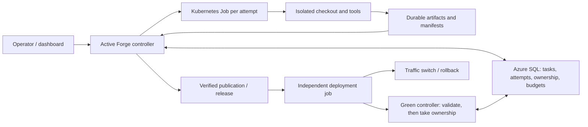
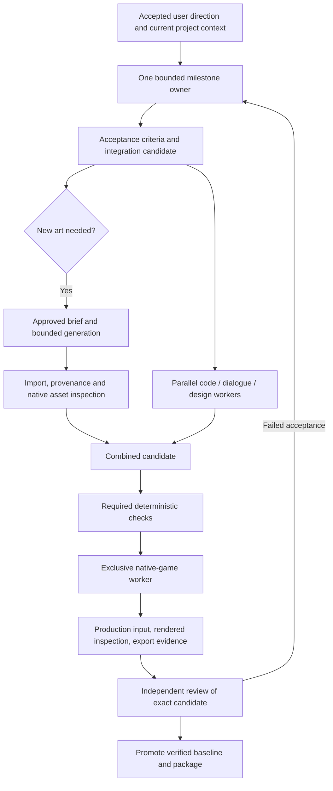

# Forge revival review and Forge-first restart plan

**Review date: November 16, 2026. Scope: analysis and plan first.** Settled requirements: use the existing Linux host initially, discard the old service workload/state, retain the existing Azure SQL service for Forge persistence, and prioritize correctness. The recommended sequence is Forge first, TimeLoop second. Migration, deployment, paid evaluations, and game changes remain future work. SSH access and plugged-in availability settings were separately requested and applied.

## Recommendation

Revive Forge by retaining its engineering infrastructure and repairing the boundaries between stages. Do not start with a rewrite, and do not start by changing only the model name. Current Forge already has worktree isolation, project queues, recovery, model routing, event-driven scheduling, and revision-specific QA/review. The highest risks are deterministic coordination defects and missing TimeLoop capabilities. A stronger model will not repair those by reasoning harder.

**Make Forge its own first project in an empty registry, then add TimeLoop.** First establish the minimum trusted build, model, worker, publication and deployment foundation interactively. Then prove the complete loop on a bounded Forge change: plan, isolated execution, tests, review, merge, immutable release, self-deployment and rollback. The old Forge registration is irrelevant to that fresh start. Do not require the currently untrusted service to repair the machinery it needs to repair itself.

**Target single-node K3s, with Kubernetes Jobs for isolated agent attempts.** This is justified by the requested worker isolation, durable execution tracking and independent self-deployment. Use one controller implementation and one production worker backend initially; an intermediate Docker production platform is optional, not a prerequisite. Azure SQL remains Forge's authoritative state store. Use embedded etcd for Kubernetes's separate cluster metadata, not SQLite; Azure SQL is not a supported K3s cluster datastore. The first node has enough baseline capacity to evaluate this, but native-game concurrency still needs measurement. [K3s datastores](https://docs.k3s.io/datastore), [requirements](https://docs.k3s.io/installation/requirements).

For TimeLoop as project two, use **one milestone owner, bounded parallel contributors, one integrated candidate, and a real native-game acceptance gate**. Keep its native GPU worker separately qualified while CPU jobs establish the Forge workflow. Design/art are conditional work with accepted deliverables; dialogue uses the existing authoring/simulation model. Avoid new generic narrative or game-testing frameworks.

## Evidence and reading guide

| Report | What it establishes |
|---|---|
| [Workflow review](workflow-review.md) | Actual pipeline, code-level blockers, concurrency/recovery/merge risks, simplification opportunities, exact source references |
| [OpenAI migration review](openai-migration-review.md) | Protocol compatibility, tools, streaming, cancellation, usage/budgets, current official model/credit documentation, migration contracts |
| [TimeLoop compatibility review](timeloop-compatibility-review.md) | All six repository skills, art/dialogue/design requirements, native verification, project capability matrix, integration acceptance |
| [Validation review](validation-review.md) | Build/test/harness receipts and independent classification of all 13 failed tests |
| [Host review](host-review.md) | Actual Linux hardware/service/configuration, live queue observations, SSH outcome, remaining host qualification |
| [Deployment review](deployment-review.md) | Current self-deployment weaknesses, SQL ownership limits, installer and blue/green deployment contract |
| [Worker platform review](worker-platform-review.md) | Docker/Kubernetes tradeoffs, per-attempt Jobs, TimeLoop GPU/container requirements and durable artifacts |

Four investigations ran in parallel (three delegated reviews plus coordinating build/operations review), followed by independent cross-checks of important findings. This is a broad source and operational review, not exhaustive proof of every endpoint or interleaving. Findings distinguish source evidence, executed checks, historical receipts, and proposals.

Pinned sources:

- Forge: [`4ac44895c05122ff5705a32b4ceb93e60a6e72e5`](https://github.com/Xyrces/Forge/commit/4ac44895c05122ff5705a32b4ceb93e60a6e72e5), also verified through the live build-info endpoint.
- TimeLoop: [`d3365cfdb900820d31842cd5d888eb2b81a5fdbe`](https://github.com/Xyrces/TimeLoop/commit/d3365cfdb900820d31842cd5d888eb2b81a5fdbe). The user's screenshot independently confirms this baseline.
- Original Windows Forge checkout: `6d0219f`; existing local edits and untracked architecture/worktree material were preserved. Current-source review used a separate detached worktree under `.portHorizon/review-sources/Forge-main`.

TimeLoop's latest Mara notebook story and cabling idea were identified in the user's screenshot as outside tracked design documents. Those materials were not reviewed. They must become explicit project context before Forge makes narrative/design decisions based on them.

## How work actually moves today

```mermaid
flowchart LR
    A[User intake] --> B[Epic and spec]
    B --> C[Product refinement]
    C --> D[Design]
    D --> E{Visual work?}
    E -->|No| G[Grooming]
    E -->|Yes| F[Designed]
    F --> ART[Meshy artist]
    ART --> READY[AssetReady]
    READY --> G
    F -->|Competing path today| G
    G --> T[Incremental stories and tasks]
    T --> S[Sprint assembly]
    S --> W[Task worktrees and agents]
    W --> V[Verification and PR]
    V --> Q[Optional QA then review]
    Q --> M[CI and merge gates]
    M -->|Failure| R[Rework / park / triage]
    R --> W
    M -->|Success| DONE[Merge and cleanup]
```

The design intent is understandable: turn ambiguous requests into bounded work; isolate simultaneous changes; require observable evidence; recover from crashes and provider failures. The implementation is now event-driven with periodic reconciliation, so the older picture of every stage waiting for a five-minute poll is outdated. Stores are authoritative; messages are wake-up hints. Every engineering task belongs to a sprint, while PR watching continues independently.

Two important gaps in this map are real behavior, not just documentation issues: Designed work can enter grooming while art is still being produced, and newly written tasks can reach sprint assembly before grooming has finished creating the complete dependency plan. The dashboard's editable flow graph also omits Artist and QA and is not a complete executable model of this pipeline.

## What prevents a trustworthy restart

| Priority | Finding | Consequence | Required outcome |
|---|---|---|---|
| Before any autonomous dispatch | Partial grooming tasks can be scheduled immediately; failed grooming can stay stuck | Work starts without complete dependencies, or is stranded after a timeout/restart | A validated, committed planning generation; no task eligible before it; resumable/idempotent failure handling |
| Before art work | Artist and groomer compete for Designed; creative stores/output roots remain primary-project-bound | Missing assets, wasted generation, or assets invisible to their owning project | Project-bound creative context and explicit artifact readiness/acceptance |
| Before project verification | Dispatch mapping drops configured verification commands | TimeLoop-specific checks can fall back to generic detection | One canonical project mapping; prove actual configured commands run through composition |
| Before current frontier models | Forge's OpenAI adapter uses Chat Completions | An endpoint/model substitution does not provide supported frontier tool calling | Responses support with correct tools, reasoning state, images, streaming and errors |
| Before spending | Streaming intake bypasses shared usage/rate wrappers; no durable USD admission ceiling | Budget and concurrency controls do not cover all model traffic | Common buffered/streaming policy and durable reservations/usage across every stage |
| Before TimeLoop work | `.agents/skills` is not imported; role loader uses frontmatter description only | Forge misses the project's operating rules and can receive Forge-specific role prose | Tested final project instructions, relevant skill/resource loading, explicit territories and commands |
| Before visual QA | QA checks for files but cannot show those images to its model | A PNG existing can be mistaken for visual inspection | Actual multimodal image input plus source/package-bound evidence and recorded inspection |
| Before merge | Cancelled checks can count as green; merge has no expected-head precondition; isolated reruns can waive failed suites | Untested revisions or integration defects can pass | Required-check semantics, SHA-bound merge, full-suite failure retained unless explicitly accepted |
| Before recovery trust | Restart recovery follows a separate publish path | Verification can be bypassed and duplicate PR creation attempted | Shared idempotent verify/publish/reconcile operation |
| Before TimeLoop merge | No GitHub workflows/checks exist at its reviewed head; per-PR QA does not prove combined milestone acceptance | Merge waits indefinitely, or individually passing work is mistaken for an integrated game | Minimal real CI plus final integrated native/export qualification |

The detailed reports also cover cross-project in-flight ID collisions, missing lifecycle injection in the normal workflow, duplicate background-launch races, QA depending on the review toggle, project grounding leaks, retry-counter lifetime, and incomplete observability. Some can be contained by a single-project pilot, but they should remain tracked rather than be declared solved by that containment.

## What to keep and what to simplify

**Keep the boundaries that protect correctness:** authoritative state, project ownership, isolated worktrees, deterministic plan schema/territory enforcement, task dependencies, current-revision checks, explicit artifact acceptance, audit trails, bounded retries, cancellation and recovery. These are not compensations for weak reasoning.

**Simplify the expensive reasoning around those boundaries:**

| Existing mechanism | Proposed treatment |
|---|---|
| Separate product/design/art/grooming agents and repeated handoffs | One milestone owner invokes design/art specialists only when the work needs them; retain explicit accepted outputs and technical readiness |
| Fixed tiny story/task counts justified by weaker models | Use coherent acceptance and owned scope; permit a stronger worker to finish a meaningful slice rather than fragmenting it artificially |
| Full LLM plan criticism for every edit | Measure value and later propose risk-based use; retain hard schema/territory enforcement and reviewer architecture rules |
| MiniMax markup repair and provider-specific retries | Keep behind legacy adapters; do not apply by default to supported OpenAI structured calls |
| Several repeated unchanged verification runs | Reuse verified evidence only when code/tree, environment, commands and relevant inputs match; rerun after changes |
| Headroom plus runtime compaction plus large memory/skill injection | Start direct with bounded tool output, relevant context and measured native caching; keep full audit artifacts separately |
| Optional Durable execution and cloud transport | Leave off for the initial local deployment; avoid maintaining two active recovery/execution paths during migration |
| Automatic weak-model retries and escalation | Start with capable models appropriate to the task; leave autonomous triage opt-in until its benefit and cost are measured |
| Editable diagram plus several independently encoded stage models | Make the UI describe real stage contracts; reduce duplicated semantics before adding more policies |

Talaria's event interface is already useful and is not the first bottleneck to replace. It can remain in-process within the controller; cross-pod execution needs a versioned worker protocol and durable reconciliation, not a shared in-memory bus. Likewise, keep MAF while adding a tested Responses adapter so the model protocol and agent framework do not change together.

## Forge-first deployment target

The installer should be one repeatable operation using a versioned release bundle: qualify the host, provision pinned K3s and its supported metadata store, configure references to Azure SQL and secrets, apply the Forge workload, and report verified readiness. First installation needs host administration; normal self-updates need only a restricted deployment identity. Keep agent workers unable to administer the cluster or replace the controller. Do not mount a host Docker socket into ordinary agent jobs.

Red/green (commonly called blue/green) means two controller versions can coexist while **only one owns dispatch and publication**. Start green without side effects, validate configuration and schema compatibility, stop blue admitting work, transfer database-fenced ownership, switch traffic and retire blue. Require existing worker Jobs to survive controller replacement and be reconciled by the new controller: their ownership/cleanup manifests must not attach them to the retiring controller pod or prune them during rollout. The deployment operation itself must outlive both versions, use a pinned release digest and restricted credentials, and be resumable through the installer if Forge is unavailable. Green's warm-up must not run mutating schedulers or automatic migrations merely because its HTTP health endpoint is healthy.

Use one explicit migration job and backward-compatible schema changes across the rollback window. Image rollback alone cannot undo an incompatible database migration. A failed deployment should preserve the old release or restore it under a new ownership generation; it must not resurrect a stale dispatcher. The current systemd symlink/restart executor does not provide these guarantees.

Kubernetes may start an attempt more than once, even with single-completion settings. Persist a run identity, ownership token and accepted result in SQL; make publication idempotent and reject late results from superseded attempts. Ownership must also gate model-spend/tool admission and external side effects: rejecting a stale result cannot undo charges or PRs produced with unrestricted credentials. Route those actions through controlled capabilities and reconcile uncertain outcomes before repeating them. Kubernetes controls process lifecycle; Forge retains semantic retry, budget and acceptance policy. [Kubernetes Jobs](https://kubernetes.io/docs/concepts/workloads/controllers/job/).

Keep accepted transcripts, patches, captures, assets, packages and release manifests in durable artifact storage, with hashes/references in Azure SQL. Azure Blob Storage is a natural proposed artifact destination alongside the existing SQL service; immutable images need a recoverable OCI registry as well. Local checkouts and caches are disposable. A single-host cluster cannot keep executing through the loss of that host; portability comes from a tested reinstall/reconciliation path, off-host application state and artifacts, plus recoverable configuration/secrets. In particular, SQL ciphertext is insufficient without Forge's DataProtection keyring or an explicitly migrated secret mechanism. Embedded etcd snapshots protect cluster metadata but do not replace that application recovery contract.

## Proposed TimeLoop operating model

This is a proposed operating model, not a claim the current workflow editor can configure it today. The smallest implementation can use one coherent milestone PR and bounded contributors. A generalized integration-branch service is unnecessary until experience proves a need.

### Art

Represent an asset as a versioned requirement and candidate, with references, generation parameters/provider job IDs, cost, provenance, AI labeling, file hashes, scale/material expectations, import result, and an acceptance verdict. A successful Meshy download is not acceptance. Provide reference-image generation only where needed, geometry/material inspection, and native rendering. Preserve TimeLoop's bounded generation policy; older four-asset authorizations are not a recurring allowance. Keep paid generation disabled until a concrete brief and spending cap are agreed.

### Dialogue and design

Use the existing `.torch`/native-resource/WorldProgression authoring path. Verify stable IDs, guards, effects, exact timing, interruption, save/load, current world versus retained knowledge, and in-game readability. Avoid a new dialogue microservice or parallel content format. Keep proposals distinct from accepted direction, and reconcile the untracked Mara/cabling context before assigning narrative scope.

### Gameplay and acceptance

Reuse TimeLoop's production-input API and maintained scenario helpers. A native worker owns its process, saves, API port, renderer/export lease and evidence directory. It returns asynchronous job status, logs, captures and manifest; the model sees actual images. Test applicable scenes at 1600×900 and 1280×720, then verify the final integrated source/export. Separate directed scenario coverage from a genuinely blind first-contact playtest. Do not use injected outcomes or a headless run as substitutes for rendered normal-entry acceptance.

Preserve current and one fallback package per renderer, compact evidence and provenance before deleting worktrees. Prefer immutable evidence references over Forge's force-pushed QA branch policy, which conflicts with TimeLoop's checkpoint rules.

## OpenAI model and credit approach

The official documentation confirms the subscription credit benefit, initial proration and expiry at the billing boundary. The reported $141 is the user's balance; this review did not inspect billing or model entitlements. Credits belong to the linked API organization. [Official credit guide](https://developers.openai.com/api/docs/guides/chatgpt-api-credits).

Use Responses for current frontier tool calling. Correct the preflight path, unsupported sampling parameters, output/reasoning controls, streaming policy, image handling and cancellation before switching live roles. [Current migration guide](https://developers.openai.com/api/docs/guides/latest-model).

Suggested evaluation candidates: GPT-6.1 Sol for coordination and engineering; GPT-6.1 Terra for visual inspection/dialogue plus a bounded engineering comparison; and GPT-6 Astra directly for difficult temporal/causal design or high-consequence review. This is a test matrix, not an assertion they have passed TimeLoop tasks or that the most expensive choice is always best. The user's correctness preference argues for comparing acceptance and false approvals first, then latency and cost. Choose stronger reasoning at task admission where justified rather than requiring failed cheap attempts first.

Track cost by project, milestone, task, stage and model, including cached/uncached input, output/reasoning, image/tool charges and external art costs. Reserve before admission so concurrent requests cannot each spend the remaining allowance. Put a small operator-selected evaluation envelope inside the $141 balance and retain the rest until results are known. A dashboard estimate is not a hard cap, and expiry is not a reason to spend blindly. Current verified token rates and illustrative arithmetic are in the migration report; no paid API or asset job was run here.

## Implementation order and completion criteria

Each row is a bounded future work package. These should become Forge tasks only after the operator chooses to proceed; this review did not enqueue them.

| Order | Work package | Dependencies and pass condition |
|---|---|---|
| 0 | Establish supported build and fresh Azure SQL baseline | Reconcile local source edits with current main on a feature branch; fix the audited dependency; normal Linux build, offline suite and fake harness pass. Stop/disable the old service and retire its ownership before resetting only Forge-owned state on the existing Azure SQL service; register only Forge. Do not migrate old backlog, memory, project registrations or overrides. |
| 1A | Repair planning and lifecycle correctness | Atomic/staged grooming output, retryable attempts, art-required readiness, canonical project context; controlled interleaving and restart tests show no premature dispatch or lost work. |
| 1B | Build Responses and common invocation policy | Can run in parallel with 1A. Fake HTTP contracts prove tools, streaming, images, reasoning state, usage, output caps, permanent/transient errors and cancellation. Add durable spend reservations. |
| 1C | Define worker and deployment contracts | Can run alongside 1A/1B. Build a pinned worker image; version the run/result protocol; persist attempt ownership, fencing, cancellation, budget reservations and artifacts in SQL/durable storage. Define controller leadership and release compatibility. |
| 2 | Unify verification, publish and recovery | Depends on 1A/1C. Same verified revision across normal/restart paths; existing PR adopted after crash; cancelled checks fail; moving-head merge rejected; full-suite failures stay visible. |
| 3 | Qualify K3s Jobs and the installer | Depends on 1B/1C/2. One command installs the pinned release and verifies readiness. Jobs recover across controller replacement; duplicate launch, stale completion, cancellation, SQL interruption and node restart behave predictably. Keep one active controller and initial concurrency low. |
| 4 | Prove Forge building and deploying Forge | Depends on 1A–3. One bounded, non-foundational Forge task completes the full loop. An independent deploy operation validates green, transfers ownership and switches traffic. Inject failed health and restart failures; demonstrate rollback without lost work or duplicate PRs. |
| 5 | Add TimeLoop as the second fresh project | Load its actual `.agents` skills, project instructions, territories, verification commands and branch policy; reconcile outstanding story context. Prove no state/artifact leakage between projects. |
| 6 | Qualify native QA, art acceptance and TimeLoop CI | One qualified GPU worker; actual model image inspection; source/package manifests and immutable evidence; real required GitHub checks and integrated export/native acceptance. Qualify GPU containers separately rather than assuming device access proves native playability. |
| 7 | Conduct a bounded TimeLoop pilot, then expand | Verification-only route first, then one small code/dialogue slice and accepted-asset import. Measure accepted outcomes, false passes, interventions, cost and stage times before adding generation or raising CPU/GPU concurrency. |

Do not make the migration contingent on a broad UI redesign, a generic multicloud platform, a separate service for every role or a full rewrite. Implement the enabling fixes interactively on feature branches while the affected automation is untrusted, then make Forge its first workload. Do not hand-merge or patch individual stuck production tasks around that loop. The Kubernetes execution seam complements the SQL state machine; it does not require activating the optional Durable Task Scheduler path too.

## What validation actually showed

- The ordinary current-main build fails on an audited transitive `System.Security.Cryptography.Pkcs` 9.0.13 dependency through SqlClient 7.0.2. Microsoft lists fixed versions including 9.0.21 and 10.0.13; select the supported dependency update during implementation. The advisory concerns Windows CMS decoding; this review does not claim that the Linux service is exploitable through that path. [Microsoft advisory](https://github.com/dotnet/runtime/security/advisories/GHSA-2fmv-rv2c-59x7).
- A diagnostic build with audit disabled compiled. This was not a source/configuration change or a passing normal build gate.
- The offline Windows run executed 1,522 tests: 1,509 passed, 13 failed. Failures comprise eight unavailable Linux-shell launches, two Unix-permission fixture failures, two Git-object cleanup access errors, and one deeply nested Git path failure. A passing expected-failure test also masked that early path failure. Details are preserved in the validation report.
- The deterministic engineering harness stopped at AgentCompleted and opened no simulated PR. Missing Linux shell is a strong inference from the code path, not a captured inner exception.
- Current deployed revision, live heartbeat, registered projects, stage gates, hardware and effective service settings were verified over the user's host. Linux tests, a new native playthrough, paid OpenAI tool calls, asset generation and the proposed new integration path were not executed.

## Settled direction and remaining launch inputs

Old service data can be discarded; Azure SQL is required; the existing Linux machine is the initial host. These are settled and should not be presented as questions again. Recommend Forge first, K3s as the worker/deployment target, and TimeLoop second. The fresh registry should contain no inherited projects or queued work. This report is the reviewable implementation proposal, not a completed migration.

Before a paid evaluation, obtain only genuinely missing inputs: the linked API organization/project, confirmed available credit/expiry, and evaluation spending ceiling. Select the first small Forge task after the foundation is working. TimeLoop's first milestone and untracked story context can wait until project two. No old workload, model, deployment or stage gate was changed during this review.
