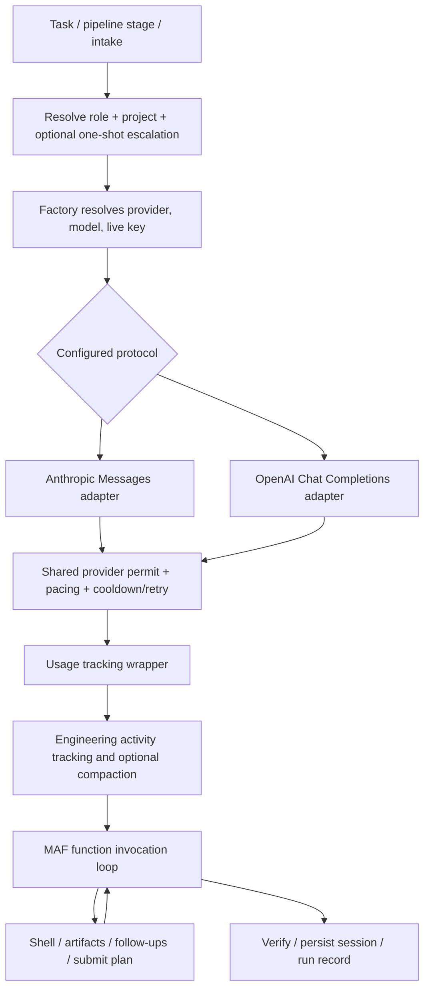

# Forge → OpenAI: runtime and migration review

Reviewed 2026-11-16. **Source baseline: current remote main `4ac44895c05122ff5705a32b4ceb93e60a6e72e5`**, inspected at `C:/Users/jtn50/repos/Forge/.portHorizon/review-sources/Forge-main`. All code references below refer to this baseline, not the older working checkout. Initial investigation of `6d0219f` was superseded; notably, current main already adds per-run token accounting, optional compaction, independent pipeline model roles, project overrides, and model escalation. No paid model calls, production changes, or secret reads were performed. Build/test validation belongs to the coordinating review.

## Decision

Keep Forge's task/state/store/worktree/PR infrastructure and its `IChatClientFactory` seam. Add a native OpenAI Responses implementation behind that seam before changing production models. **Changing only the base URL and model ID is insufficient:** current frontier models require Responses for tool calls, while Forge's OpenAI path builds a Chat Completions client. Establish durable spending controls and run representative TimeLoop evaluations before autonomous dispatch.

The credit benefit is real: OpenAI documents $200/month for the $200 Pro tier, with an initially prorated grant and expiry at the subscription billing boundary. It is linked to an API organization. The reported $141 balance is user-provided, not independently checked; a prorated grant is a possible explanation, not a finding about this account. [Official credit guide](https://developers.openai.com/api/docs/guides/chatgpt-api-credits).

## Existing request flow

This is a conceptual assembly map, not literal execution order: outbound calls traverse outer MAF wrappers toward the provider. Pipeline agents construct their own function loops; intake uses streaming. Those differences matter for policy coverage.

References: `Agents/OpenAICompatibleChatClientFactory.cs:114`, `Agents/MafAgentRunner.cs:762`, `Agents/IntakeAgent.cs:271`, `Agents/PipelineAgentRunner.cs:75`.

## Findings that block a reliable migration

### P1 — Current frontier tool calling cannot use Forge's existing OpenAI adapter (high confidence)

`Agents/OpenAICompatibleChatClientFactory.cs:260` handles Anthropic specially, then unconditionally calls `GetChatClient(model).AsIChatClient()` at lines 294–295. `Agents/LlmConfig.cs:17` defines the default protocol as Chat Completions. There is no Responses branch.

OpenAI's current guide explicitly requires Responses for tool calling on `gpt-6-astra`, `gpt-6.1-sol`, and `gpt-6.1-terra`. GPT-6 Sol/Luna permit Chat Completions function calling only with reasoning disabled. These are API constraints, not judgments about model quality. [Migration compatibility](https://developers.openai.com/api/docs/guides/latest-model).

**Action:** introduce an explicit Responses protocol with function-call/result pairing, reasoning-item preservation, image input, usage mapping, and cancellation tested at the factory seam. Retain legacy adapters for rollback; do not rewrite the entire orchestrator or switch to another orchestration SDK simultaneously. Confirm the selected .NET/MAF adapter preserves Responses-specific state rather than flattening it into text. The [official .NET library](https://github.com/openai/openai-dotnet) includes Responses support, but compatibility with Forge's pinned package versions still needs a compile-and-contract spike.

### P1 — Streaming intake bypasses shared rate and cost policy (high confidence)

`Agents/IntakeAgent.cs:271` calls `RunStreamingAsync`. Both `RateLimitAwareChatClient` (`:103`) and the factory's `UsageTrackingChatClient` (`Agents/OpenAICompatibleChatClientFactory.cs:176`) override only `GetResponseAsync`. Their streaming path delegates directly to the inner client, missing the semaphore, pacing, cooldown classification, and aggregate usage recording. This is already a live path, not merely a future streaming concern.

The delegation behavior was independently verified against the exact source commit recorded in the installed `Microsoft.Extensions.AI.Abstractions` 10.7.0 package metadata (`fa0072f10f11eae347aaecaa3c3e81e701b0f79d`): [`DelegatingChatClient.GetStreamingResponseAsync`](https://raw.githubusercontent.com/dotnet/extensions/fa0072f10f11eae347aaecaa3c3e81e701b0f79d/src/Libraries/Microsoft.Extensions.AI.Abstractions/ChatCompletion/DelegatingChatClient.cs) directly invokes the inner client's streaming method, not the buffered virtual method. Thus this is a demonstrated source-path gap; no production experiment or paid request was needed.

**Action:** make admission/release and final usage aggregation common to streaming and buffered calls. Test disposal midway through streaming, exceptions before first token, terminal usage-only chunks, and tool continuations. Do not count each streamed delta as a full request.

### P1 — No enforceable direct-API spending ceiling (high confidence)

`Core/CostTracker.cs:26` retains aggregate input/output counts and only 200 recent records in memory, with role strings but no provider/model/project/task/cost. `Configuration/AgentOptions.cs:123` declares `Headroom.BudgetUsd`; no C# enforcement consumer exists. Headroom is optional and is not the right owner of a direct OpenAI budget.

Current main **does** persist per-run input/output and cache-read counts through `ActivityTrackingChatClient.cs:72` and `MafAgentRunner.cs:566`; the old checkout's hardcoded-zero problem is fixed. However, cache accounting is Anthropic-shaped (`cache_read_input_tokens` and `cache_creation_input_tokens`), and neither durable billing nor an admission budget follows from those run totals. Pipeline calls and streamed intake also need coverage.

**Action:** durable usage ledger with request ID, project/task/run/stage, provider/model, input/cache-read/cache-write/output/reasoning/tool fees, timestamp, price revision, and an estimated-versus-reconciled distinction. Admit requests against a reserved upper bound so concurrent calls cannot all spend the last available credit. Enforce pilot/run/day/total limits and stop new admissions when reached; preserve resumable state. Include image/Meshy costs separately. OpenAI credit balance and Forge's allocation are different quantities.

### P1 — Preflight uses a different and incompatible request shape (high confidence)

`Program.cs:882` appends `/v1/chat/completions` to `BaseUrl`, while the SDK client expects an API-root endpoint. With `https://api.openai.com/v1`, preflight requests `/v1/v1/chat/completions`. It sends `max_tokens=4` (`:887`), checks only the default provider/model, and emits Kilo-specific errors. A successful preflight would still not establish tool compatibility for every role.

**Action:** use the same provider resolution and protocol client as production. Separate config-only checks, connectivity/auth checks, and an explicitly bounded billable tool-roundtrip probe. Inspect every effective role and escalation target, including DB overrides.

### P1 — Model parameter controls are Anthropic-specific; memory extraction sets an incompatible sampling parameter (high confidence)

`LlmProviderOptions.MaxOutputTokens` exists (`Configuration/AgentOptions.cs:342`), but the factory applies it only to `AnthropicMessagesChatClient` (`:268`). For OpenAI it is used as compaction reserve, not a request output cap. `ThinkingBudgetFor` is explicitly ignored outside Anthropic (`:207–226`); no OpenAI reasoning effort is configured.

`Orchestrator/MemoryExtractor.cs:92` explicitly sends `Temperature=0` on the Intake model. Current OpenAI guidance disallows temperature with reasoning enabled. The plan critic's `MaxOutputTokens=1024` (`Agents/Gates/PlanLlmReviewGate.cs:80`) also needs evaluation for reasoning models, where reasoning consumes output budget. [Parameter compatibility](https://developers.openai.com/api/docs/guides/latest-model).

**Action:** model capability policy for reasoning effort, output reserve/cap, image support, protocol, context size, service tier, and unsupported parameters. Configure it per actual model, not only per provider; several OpenAI models can share one provider with different constraints.

### P1 — Shell cancellation is disconnected from agent cancellation (high confidence)

`AgentTools/BashTool.cs:193` explicitly calls the shell method with `CancellationToken.None`. A cancelled run can continue executing its shell command until the tool's independent timeout (up to 300 seconds). `:169` kills the process tree only on its local timeout; general cancellation is converted to a text error by the outer catch. This matters for stop controls, budget stops, recovery, and gameplay automation.

**Action:** bind the invocation cancellation token, kill and await the process tree on either cancellation path, then propagate cancellation without making it look like a normal tool response. Verify no child game/editor/build process remains after cancellation.

### P2 — Credential and billing identity are global even when model routing is project-specific (high confidence)

`ProviderApiKeyResolver.cs:37,61,81` takes the first available key across projects and caches it by provider name alone. Factory `Create` accepts project ID but key lookup uses only provider name (`:133`). `OpenAICompatibleChatClientFactory.cs:284` silently ignores `OrgId`. Thus project model isolation does not imply project credential/billing isolation.

**Action:** either make OpenAI credentials explicitly global with a documented organization/project, or resolve them by the requesting project. Use the API project belonging to the credit-linked organization. Do not present an ignored organization field as functional. Avoid putting secret values in configuration examples or logs.

### P2 — Unbounded tool output and uneven compaction can consume time, context, and credit (high confidence)

`BashTool.cs:151–179` buffers full stdout/stderr and returns it. `MafAgentRunner.cs:762–801` has useful intra-loop compaction, but it is opt-in through provider `ContextWindowTokens`; the stored session and audit transcript remain full. The reducer is not part of the common factory, so pipeline agents' independent loops do not automatically receive it. `MafAgentRunner.cs:1093` injects complete loaded skill bodies and `:1173` recalls broad memory before assembling the prompt.

**Action:** bounded previews plus artifact-backed full output retrieval; skills catalog with on-demand loading; task-relevant memory; compact provider-bound histories with preserved tool pairing. Set a practical context budget below the model maximum and below premium long-context thresholds where possible. Large advertised windows do not make repeated whole-history transmission free.

### P2 — Provider-specific retry assumptions need OpenAI classification (high confidence)

Current main has better pressure handling than the old checkout: provider pacing, overload retries with released permits, shared quotas, and account-quota cooldowns (`RateLimitAwareChatClient.cs:103–199`). Keep that machinery. However, `LlmRateLimitException.cs:79` classifies MiniMax codes 2056/2062 and text signatures; OpenAI exhausted-credit errors are not explicitly distinguished from transient request-rate errors. The SDK may itself retry before Forge sees an error; coordinate retry ownership to avoid multiplied delays. OpenAI documents automatic SDK retries in its [official .NET library](https://github.com/openai/openai-dotnet).

A smaller bug remains: the factory documents `MaxConcurrentRequests=0` as disabling the permit, but when RateLimits is configured, `Math.Max(1, MaxConcurrentRequests)` creates a one-slot semaphore (`OpenAICompatibleChatClientFactory.cs:248–252`). Cooldown is checked before waiting for a permit, not again afterward, so already queued callers can enter after another caller establishes cooldown.

**Action:** typed insufficient-credit/auth/model-access/rate/overload/context error outcomes; no automatic retry of permanent configuration or billing failures. Make actual quota scope explicit. Test queued admissions, zero cap semantics, and combined SDK/Forge retry counts.

## Capabilities retained and missing for TimeLoop

Keep project-scoped model overrides (`RoleModelOverrides.cs:184`), first-class Groomer/Designer/Artist roles, one-shot escalation, deterministic plan/schema/territory controls, state machine transitions, head-specific review, verification, and crash recovery. These solve coordination and correctness problems that stronger models do not remove.

Current art agents still exchange text/string tools and Meshy jobs (`Orchestrator/ArtistAgent.cs:236`); there is no model-visible screenshot/image input path in the inspected runtime. Designer/Artist use playbook-based instructions and artifact stores, not a general interactive game/media runtime. Model vision capability alone cannot inspect a render on disk. A gameplay runner needs explicit launch/reset/input/screenshot/state/log APIs, exclusive ownership of a game instance, deterministic test scenarios, and retained evidence. Art needs controlled generation/import/preview/acceptance; dialogue needs asset-format validation, branch coverage, and in-game checks. These adapters belong around the model, not in prompts claiming tools exist.

The native Responses migration is the appropriate place to preserve typed image inputs and tool outputs. Do not add a separate LLM orchestration framework just to gain screenshots. Use the TimeLoop review to define exact adapters and acceptance criteria.

## What to simplify after measured validation

| Mechanism | Recommendation | Reason |
|---|---|---|
| MiniMax literal-tool-markup recovery | Provider-specific compatibility module, disabled for OpenAI after evaluation | `LeakedToolCallMarkup` and both runner continuation paths address a known provider defect; successful structured calls should not need it. |
| 200 tool iterations per request | Keep a hard limit, replace one-size-fits-all allowance with bounded task policy | A high ceiling can hide aimless exploration and runaway spend; arbitrary reduction can truncate valid work. |
| LLM plan critic on every engineering task | Measure first; propose risk-based application later | Useful independent judgment, but adds latency and another model call; task text is truncated at 4,000 chars (`MafAgentRunner.cs:214`). Do not remove deterministic enforcement or weaken reviewer architecture rules. |
| Three in-session verification rounds plus executor verification | Reuse successful evidence only when commit/tree/environment match | Backstop is valuable; repeated unchanged expensive tests are avoidable. Preserve recheck after mutation. |
| Headroom compression proxy | Start direct OpenAI with proxy disabled | Avoid protocol rewrites and a second state/compression layer; use bounded context and native caching measurements first. |
| Kimi/Minimax retry and auth branches | Retain isolated legacy adapters until rollback no longer needed | Their historic fixes are not generic OpenAI policy. |
| Separate MAF and custom pipeline continuations | Consolidate common invocation/usage/cancellation policy | Current divergence already allows streamed intake to bypass shared controls. |
| Deterministic state/ownership/recovery guards | Keep | Model strength does not guarantee exactly-once side effects or cross-project isolation. |

## Proposed model baseline and spending experiment

Use `gpt-6.1-sol` for initial engineering, grooming, and review evaluations; compare Terra for visual checks and dialogue, and reserve Astra for difficult diagnosis/escalation. This is a proposed benchmark starting point, not a claim that a specific model has passed TimeLoop tasks. Do not first optimize for the cheapest model when the stated priority is correctness. Product/refinement currently still uses CoreDev (`Agents/ProductAgent.cs:180`); memory extraction uses Intake without project ID (`Orchestrator/MemoryExtractor.cs:87`), so audit those exceptions during routing.

Verified standard short-context rates per million tokens:

| Model | Input | Cached input | Output | Source |
|---|---:|---:|---:|---|
| gpt-6.1-sol | $2.00 | $0.10 | $10.00 | [Sol model card](https://developers.openai.com/api/docs/models/gpt-6.1-sol) |
| gpt-6.1-terra | $1.00 | $0.05 | $5.00 | [Terra model card](https://developers.openai.com/api/docs/models/gpt-6.1-terra) |
| gpt-6-astra | $10.00 | $1.00 | $50.00 | [Astra model card](https://developers.openai.com/api/docs/models/gpt-6-astra) |

For illustration only, **one million total uncached input tokens plus 100,000 billed output tokens across a run** costs $3 Sol, $1.50 Terra, or $15 Astra at these rates. Those totals include every round-trip, not just the initial task. This is arithmetic, not a forecast of task count. Cache writes, premium context, images, external tools, and service tiers can change it. Sol/Terra model cards specify higher pricing beyond 272K input and separate cache-write pricing; no savings assumption should precede measured billing.

Proposed pilot envelope: allocate a small fixed fraction of the reported $141 to evaluation, keep most in reserve, and stop admission before that envelope is exhausted. Exact caps and billing-cycle expiry should be selected with the operator once the offline review has produced a concrete launch configuration. No paid probe was run during this review.

## Migration acceptance sequence

1. **Offline contract spike:** compile a Responses-backed `IChatClient` against the chosen package versions. Fake HTTP tests prove exact endpoint, reasoning/output parameters, function schema defaults, multiple tool calls, tool errors, image input, refusal/incomplete outputs, state persistence, and unknown response items. Keep legacy adapter contract tests.
2. **Common policy layer:** cover buffered and streaming calls; durable usage/reservations; correct OpenAI cache/reasoning counts; typed quota/auth errors; cancellation; safe cached-client lifetime. A cached client is currently disposed through per-run wrapper disposal (`MafAgentRunner.cs:657`, factory cache `:229`); verify this with a disposable fake before declaring a runtime defect, since the concrete SDK adapter's disposal behavior matters.
3. **Routing/preflight:** explicit Responses protocol, organization/project identity, all normal/escalation roles, no stale DB overrides, output/context policies, Headroom off. Fix preflight before using its result as launch evidence.
4. **Representative offline replay:** malformed tool arguments, rate limit during review, restart during tool execution, partial streaming, stale session, exceeded context, duplicate side-effect requests, and hard budget exhaustion. State/store invariants must survive.
5. **Bounded live model evaluation:** one controlled coding fix, one narrative asset change, one visual asset/import check, and one gameplay scenario using TimeLoop's actual procedures. Measure correctness, accepted artifacts, false approvals, rework count, human intervention, latency, and all-in cost. Textual self-reports are not completion evidence.
6. **Single-project canary:** clean TimeLoop registry/state with explicit holds, one active task, documented acceptance evidence, no historical queue replay. Release concurrency only after measured limits and recovery checks pass. Retain the ability to stop new work without destroying records.

## Remaining uncertainties

- Credit organization, balance, expiry, API key availability, actual account model access and rate limits were not inspected.
- Adapter support in Forge's pinned packages needs implementation-time compilation and HTTP contract tests; official current SDK examples are not proof of installed-version compatibility.
- No claim is made that the models have passed TimeLoop gameplay/art/dialogue work; the companion TimeLoop analysis defines those workloads.
- Reports of existing production behavior are not available here; findings are source-level except official API facts. All source line references must be read at the baseline SHA above.
