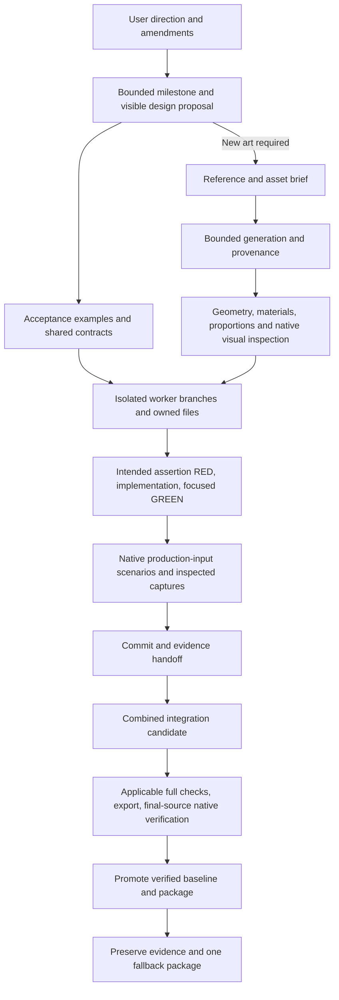

# TimeLoop compatibility review

Reviewed 2026-11-16. This is a source review, not a claim of fresh gameplay verification. The user's clarified scope is review and planning first; all pilot steps below are future proposals, not actions taken or queued.

Subsequent planning update: Forge is the first restart project and TimeLoop follows second; Azure SQL is mandatory. The TimeLoop pilot below is therefore a second-stage qualification plan. See `worker-platform-review.md` for Kubernetes/Docker placement and the isolated Linux display correction.

## Sources and scope

- TimeLoop default branch `main`, pinned at `d3365cfdb900820d31842cd5d888eb2b81a5fdbe`. Read snapshot: `C:/Users/jtn50/repos/Forge/.portHorizon/review-sources/TimeLoop`. GitHub connector returned 404; authenticated local `gh` and a filtered, sparse Git clone supplied the accessible source. The tree response was not truncated. The sparse checkout includes `.agents`, `docs`, `tools`, `src/TimeLoop.Core`, `src/TimeLoop.Game` and root files. Git tree inspection covered other paths without downloading their entire history/assets.
- Current Forge comparison: `4ac44895c05122ff5705a32b4ceb93e60a6e72e5`, snapshot `C:/Users/jtn50/repos/Forge/.portHorizon/review-sources/Forge-main`. This is materially newer than the original working checkout. Findings below refer to this newer version unless stated otherwise.
- All six TimeLoop SKILL.md files were read, together with AGENTS.md, current status, relevant amendments, development/architecture/verification instructions and representative authoring/test helpers. Current Forge AGENTS.md and CONTRIBUTING.md were also read.
- No live game, exported package, Meshy job, paid model request, PR, remote mutation or production service was started. Reported TimeLoop test results below are repository receipts, not reruns.
- During synthesis, the coordinator reported a new user-supplied screenshot identifying a newer Mara story notebook and a cabling-idea chat outside the tracked repository. Their underlying content was not inspected in this source review. Reconcile that current design context before selecting implementation scope; the pinned repository must not be presented as the complete latest design authority.
- References use repository-relative `path:line`. For immutable GitHub citations, substitute the appropriate pinned SHA in `https://github.com/Xyrces/TimeLoop/blob/<SHA>/<path>#L<line>` or the equivalent Forge URL.

## Assessment

Forge can provide useful queue, isolation, recovery and review infrastructure for TimeLoop. Direct OpenAI access alone does **not** make it a replacement for TimeLoop's current coordinator. The missing pieces are principally project grounding, image inspection, reproducible native verification, asset acceptance and integration-level completion. These are tool and policy contracts, not reasoning weaknesses that a stronger model automatically fixes.

The best restart is one narrowly scoped TimeLoop milestone with a verified integration candidate, explicit project instructions and a real rendered QA worker. Keep Forge's state and branch safeguards. Do not initially enable autonomous asset purchasing, automatic narrative invention, model escalation, or a backlog of unrelated game features.

## What TimeLoop actually is now

TimeLoop is a native Godot .NET/C# research-facility game with an engine-independent .NET 10 simulation. The freighter is a historical sandbox, not the current product. Linux Raster on Radeon 890M is accepted; NRD correctness and NRD performance are different claims, with the latter failing on that hardware. Windows support and renderer choices must remain intact (`AGENTS.md:3`, `START-HERE.md:5`, `tools/linux/README.md:3`). The game project pins Godot.NET.Sdk 4.7.2 and net10.0 (`src/TimeLoop.Game/TimeLoop.Game.csproj:1`). Linux setup pins .NET SDK 10.0.103 and a patched native authoring plugin; a generic .NET service host is not automatically a qualified game-test host (`tools/linux/README.md:25`).

The newest status receipt reports nameplates following held Left Alt, 1,767 C# passes, native export and inspected 900p/720p checks, with runtime `e9943feb` and package hashes. It explicitly reports scope and limitations rather than claiming a fresh whole-game qualification (`docs/status.md:1`). Nearby receipts distinguish segmented directed routes from blind/uninterrupted playtests and note incomplete witness-follow-up content (`docs/status.md:43`). These are the standards Forge should preserve.

Authored narrative is executable content, not only prose. Native scenes/resources and `.torch` documents compile through the existing WorldProgression/ScriptRecipe path; journal resources contain presentation copy. Timing, guards, effects, memory and cancellation share the simulation machinery (`docs/architecture.md:262`). Stable IDs, references, save compatibility and current-world versus retained-knowledge semantics matter. Historical JSON fixtures exist, but replacing current authored rules with a new parallel JSON narrative engine would violate the established design.

## Current work flow and its useful controls

TimeLoop's six skills describe complementary responsibilities:

| Skill | Contract relevant to Forge |
|---|---|
| `loop-orchestrator` | One active milestone; bounded tasks; agree interfaces; exact base SHA; separate writing worktrees; actual model/effort receipts; verify combined candidate before promotion; coordinate renderer/export contention. |
| `loop-worker` | Absolute assigned worktree on every operation; owned paths; real RED/GREEN; checkpoint partial work; hand off exact commits, commands, captures and remaining failures. |
| `loop-tdd` | Observable behavior tests, exact temporal boundaries, world/knowledge isolation, interrupted actions and content branches; visual-only edits use rendered checks rather than invented unit tests. |
| `godot-gameplay-verification` | Real renderer; production player-input API; inspected images/sequences; 1600×900 and affected 1280×720; source/package identity; no outcome injection in final normal-entry/export checks. |
| `loop-visual-design` | Concrete previews before substantial design; distinguish proposals from accepted constraints; preserve feedback provenance; inspect preview and then separately verify native implementation. |
| `loop-git-checkpoints` | Verified `main`; coherent recoverable feature checkpoints; preserve ignored evidence before worktree archival; package retention; verify remote SHAs; no force-push. |

The coordinator is allowed to implement integration changes, and does not create automatic reviewer teams for each edit (`.agents/skills/loop-orchestrator/SKILL.md:13`). This is a useful simplification target for Forge: retain deterministic completion gates while avoiding mandatory extra LLM stages when the task already has clear acceptance and no design/art uncertainty.

## Capability matrix

| Need | Current TimeLoop practice | Current Forge fit | Required bridge |
|---|---|---|---|
| Project instructions | AGENTS + amendments + progressive docs; six `.agents/skills` | Imports `.kilo/skills` only; role prompt loader extracts description only | Native `.agents` support, instruction loading, project profile, role-aware progressive access |
| Code implementation | Core/native boundary, behavioral TDD, exact source evidence | Isolated worktrees, role slots, plan gates, pre-push commands | TimeLoop commands, boundaries, acceptance/evidence contract |
| Game/narrative design | Preview, proposal/acceptance distinction, authored rules | Designer saves HTML/SVG/Markdown artifacts | Repository-aware design agent and explicit accepted-design handoff |
| Dialogue | Conditions, time costs, interruption, learned knowledge, save/return | Can edit via shell; no distinct content pipeline | Existing authoring tools + semantic validation and native dialogue scenarios; no need for a new dialogue service |
| Art production | References, Meshy, AI labels, provenance, quality inspection | Meshy jobs and GLB records | Image generation, topology/material controls, credit limits, asset import and actual visual review |
| Directed gameplay tests | Local input API and maintained routes | Shell tool can drive API; new QA watch lane | Image-return tool, qualified native worker, manifest validation |
| Blind playtesting | Filtered helper in neutral workspace; actual screenshots | Task QA has code/spec context | Separate bounded first-contact session; do not mislabel directed QA as blind |
| Completion | Final integrated source/package verification | Per-PR QA, review and CI | Verify integration candidate before baseline/package promotion |
| Resources and storage | Coordinate GPU/export; preserve compact evidence, current + fallback | Per-role task pools, worktree cleanup, detached QA evidence | Renderer/export lease and evidence-preservation adapter |

## Findings requiring action before autonomous TimeLoop dispatch

### T1 — Project rules and skills are not loaded correctly (high severity, high confidence)

`Orchestrator/Composition/ForgeComposition.cs:150` seeds project skills from `Path.Combine(p.Root, ".kilo", "skills")` at line 159. TimeLoop's six skills are under `.agents/skills`; no `.kilo` tree or `agents/<role>.md` was found in the pinned tree. Consequently the automatic skill catalog imports none of them. A model could discover them through shell reading, but this is not the advertised project skill injection.

Further, `Agents/MafAgentRunner.cs:1247` loads a role file but returns only its frontmatter `description:` (`:1255`, `:1270`), ignoring the Markdown body. The fallback CoreDev and ClientDev descriptions explicitly identify Forge backend and Forge.UI (`agents/coredev.md:2`, `agents/clientdev.md:2`). The runner does not automatically load TimeLoop AGENTS.md in this instruction path. Merely writing a good role-body override would therefore not fix the actual prompt.

Current main has fixed the old hard territory fallback: `Agents/RoleAgentRegistry.cs:57` now uses only project territories, leaving unspecified roles unconstrained. The original stale checkout would reject foreign-layout plans; that is **not** the current-main bug. Current problems are misleading role prose and lack of project-specific grounding. Configure explicit TimeLoop territories and load complete rules with tests that assert the actual final prompt, not merely file discovery. Update project skill handling to retain source location, referenced resources and revision; TimeLoop's relative links and preferences file should remain reachable. Avoid indiscriminately injecting every coordination skill into every worker.

### T2 — QA cannot currently perform the required image inspection (high severity, high confidence)

The actual runner tools at `Agents/MafAgentRunner.cs:180`–`:304` are shell, submit_plan, reviewer diff paging, artifact text and follow-up filing. No screenshot/image-reading tool or image-bearing content path appears in that wiring. `AgentTools/ArtifactReadTool.cs:99` returns art file paths as text. Shell output and a PNG pathname do not let the model see the image.

New Forge QA is a meaningful improvement: `Reviewer/QaDispatcher.cs:349` checks evidence before shipping, and `:398` requires a PNG/JPG for a visual PASS. But it checks filename extensions/existence in the dirty-file set, not image decoding, inspection, dimensions, sequence coverage, source fingerprint or final package identity. TimeLoop explicitly rejects unopened captures as evidence (`.agents/skills/godot-gameplay-verification/SKILL.md:19`, `docs/verification-record.md:32`).

Add a bounded local image inspection tool that returns actual multimodal content, logs image hashes and the reviewer/model, validates the native evidence manifest and binds it to code/package identity. Preserve a distinction between automated completeness and subjective visual acceptance. TimeLoop already has `tools/TimeLoop.Verification/Evidence.cs:19` for missing/stale record checks; use it where appropriate instead of creating a second incompatible evidence system. The existing validator also cannot prove an inspection happened, as the project's record explicitly says.

### T3 — QA applicability and artifact paths mismatch TimeLoop (high severity, high confidence)

`Reviewer/QaEvidenceTierClassifier.cs:59` uses path prefixes: otherwise code-tier QA can pass with any evidence file; an entirely unconfigured project has no visual paths (`:90`). TimeLoop core timing, dialogue, knowledge, content and movement changes require native rendered scenarios even if no UI file changes. Set `$qa.enabled` and sufficiently broad `$qa.visualPaths` (initially relevant `src/`, `content/`, native/input helpers) rather than merely ClientDev's folder. Longer term use project acceptance requirements, with paths as a conservative default.

Forge QA allows output only under `test-results/` (`Reviewer/QaDispatcher.cs:580`) and rejects non-ignored changes elsewhere (`:361`). TimeLoop tooling normally writes `artifacts/...`, and imports can touch tracked Godot metadata. Provide a project QA adapter that puts durable logs/captures/manifest under `test-results/qa/<task>/`, uses isolated staging and deliberately handles known import churn. Do not loosen the gate globally to accept arbitrary changed source files.

Forge stores evidence on force-pushed scratch `agent/qa-*` branches (`Reviewer/QaDispatcher.cs:422`), while TimeLoop's checkpoint contract prohibits force pushes and uses `codex/` backups (`.agents/skills/loop-git-checkpoints/SKILL.md:122`). Resolve this explicitly: immutable evidence refs/object storage are preferable to introducing a contradictory exception. Include exact source SHA and manifest hash in the review comment.

### T4 — TimeLoop has no GitHub CI signal at its reviewed head (high severity, high confidence)

`git ls-tree -r --name-only <TimeLoop SHA> .github` returns no entries. Authenticated read-only GitHub API checks additionally returned zero repository Actions workflows, zero check runs on `d3365cfd`, and combined legacy status `pending` with zero statuses. This establishes missing CI for the reviewed head, not every historical branch. Forge's merge gate remains closed with no passing CI. `Reviewer/PRWatcher.cs:282` contains a nominal three-poll zero-signal path asking for an empty commit retrigger (`:294`–`:310`, explicitly no engineering strike). The independent workflow review identified an instance-lifetime concern: its counter is on the watcher, while event consumers rebuild bundles/watchers; therefore three ordinary composed-runtime ticks may not reach that threshold. Either way, retriggering a repository with no CI provider cannot produce checks. The primary blocker is absent CI; retry timing and possible wasted model cost are secondary, and should not be represented as a proven three-tick live behavior.

Before dispatch, inspect actual TimeLoop branch rules and establish a real minimal CI contract for restore/build/deterministic tests, with native GPU qualification provided by the appropriate worker. Do not disable all checks simply to make the merge gate green. This review did not create checks or PRs.

### T5 — Forge art production is not TimeLoop asset acceptance (high severity for art work, high confidence)

`Orchestrator/ArtistAgent.cs:236` exposes DB reads/writes plus Meshy submission. `:554` instructs the artist to submit jobs for each visual element, save results and mark AssetReady when an output exists. `:447` downloads GLBs, with a generated `art-...` path. The agent has no local Godot import/render inspection, image-generation tool, geometry review or repository integration tool. Designer likewise has DB-only tools (`Orchestrator/DesignerAgent.cs:231`) and relies on a separate playbook-memory reference rather than the TimeLoop skills (`:325`).

TimeLoop requires AI-labeled filenames and provenance (`AGENTS.md:39`, `docs/user-amendments.md:1116`), and the user explicitly rejected earlier generated geometry. The later bounded comparison specifies four reference images plus four Smart Topology t2.5 textured 2K GLBs, no paid retries, and geometry/proportions/PBR/native inspection (`docs/user-amendments.md:1786`). That past bounded authorization must not be treated as a renewable art budget for Forge.

Separate requested asset requirements from ordinary UI design. Use a manifest with source/brief, accepted references, provider task IDs, generation parameters and credit receipts, hashes, import version, dimensions/scale/materials, AI labels and explicit quality verdict. Stage candidates before accepted game assets. Keep recognizable/organic production through appropriate generators; simple structural geometry and exact diagrams can remain procedural/vector. Existing `tools/art/door-conditioning/` is evidence that conditioning is already part of the workflow. API success is not asset quality. Do not automatically run Meshy for every visual spec or interpret an art row as accepted.

### T6 — Native worker capability and long-running task support are missing onboarding gates (high severity, high confidence)

TimeLoop's supported Linux run occurs as the desktop user with native GPU/display access, matching engine/plugin/runtime versions and isolated endpoint/save directories (`tools/linux/README.md:3`, `docs/development.md:254`). Forge's normal systemd orchestration does not establish that environment. `AgentTools/BashTool.cs:60` defaults to 30 seconds and clamps requests to 300 seconds (`:105`), while build/export/native routes can exceed it. Separate pre-push verification allows 15 minutes (`AgentTools/RunVerification.cs:25`) but is not a resumable game-process supervisor.

The parent review additionally inspected `deploy/systemd/forge.service:53`–`:103`: the template sets `MemoryMax=8G`, `PrivateDevices=true`, `ProtectHome=true`, and limits writable paths to `/var/lib/forge`. Later live inspection established that the actual deployment is a user unit with `MemoryMax=infinity`, `PrivateDevices=no`, and `ProtectHome=no`; see `host-review.md`. The template therefore must not be reported as the current GPU blocker. Native worker identity/device access, exact toolchain and owned isolated compositor still require qualification. The current TimeLoop unattended route uses headless Weston/Xwayland with a real Vulkan renderer, not the user's desktop display; see `worker-platform-review.md`.

Use one qualified native worker initially, with a renderer/export lease, explicit process ownership, asynchronous job handles, cancellation, bounded logs and a final exit/manifest. Keep the orchestrator's protections rather than indiscriminately weakening its service for rendering. Reuse maintained TimeLoop commands; do not install a new game runner framework. Keep interactive saves and the currently verified package isolated from QA. A provisioned GPU host and image inspection are prerequisites to autonomous gameplay completion, not optional future optimizations.

### T7 — Per-task PR merges do not establish TimeLoop milestone integration (high severity, high confidence)

TimeLoop requires an integration candidate that combines worker changes and then runs final-source rendered/export checks before promoting verified `main` (`.agents/skills/loop-orchestrator/SKILL.md:63`, `.agents/skills/loop-git-checkpoints/SKILL.md:72`). Forge's unit is the individual task PR with head-bound QA/reviewer/CI. Independent green PR heads can still combine into a broken game or an incomplete milestone.

For the pilot use one coherent implementation PR for a milestone, with parallel workers contributing within that candidate where safe, or add a project integration-branch stage with final combined gates. Avoid implementing speculative merge orchestration before a single pilot establishes the actual need. Never label sprint completion as a verified game package without the integrated evidence.

### T8 — Automatic isolated-test success is too permissive (high severity, high confidence)

`AgentTools/RunVerification.cs:44`–`:75` retries failed dotnet tests in isolation and lets the gate pass if the selected tests pass, asserting they were not caused by the diff. That conclusion does not follow: a change can introduce shared-state/order defects visible only in the whole suite. TimeLoop's correctness and honest evidence contracts require the failure to remain recorded and resolved or explicitly accepted. Retain isolated reruns as diagnostics; do not automatically convert a failing required full suite to green.

## Dialogue and design: use the existing authoring model

A dedicated always-on narrative agent is not necessary for the restart. Route a bounded dialogue/content assignment to an implementation agent with the right authoring context and an independent focused review when warranted. Acceptance should cover conditions, exact time costs, interruption, knowledge availability, return/save/load behavior, live text wrapping and readable choice disclosure. Test semantic IDs/conditions rather than pinning incidental sentence text unless the wording itself is the acceptance criterion (`.agents/skills/loop-tdd/SKILL.md:25`).

Keep proposals and selected direction distinguishable. TimeLoop's visual skill requires a preview in a real project scenario and feedback provenance; Forge's stored HTML wireframe is a useful artifact but does not by itself mean that the user selected it or that it was rendered and inspected. Preserve accepted amendments and current scope in the project context. The present request to revive Forge is not authorization to expand TimeLoop's story or finalize unresolved setting details.

## Bottlenecks and safe simplification

- Preserve exact worktree/base/owner identity, dependency ordering, current-head review, project store isolation, bounded retries, checkpoint recovery, evidence freshness and explicit external spend. Stronger models do not replace them.
- Prefer one milestone owner plus bounded workers over an unconditional chain of product, design, art, grooming, plan critic and review calls for every small task. Make design/art conditional on the work's actual requirements. Keep automated required checks even when reducing advisory model calls.
- Use project-native acceptance manifests and maintained route helpers, not a new generic gameplay platform. `tools/playtest-input/README.md:1` already supports a deliberately filtered first-contact tester; use it only when player comprehension is the actual question.
- Serialize GPU/export work where necessary while allowing core implementation/tests in parallel. Increasing all role caps can slow or destabilize native verification.
- Progressively load relevant docs and skill resources. TimeLoop's amendments/status are lengthy historical records; a dated current-context index with traceable source links is better than repeating the entire history each model turn.
- Keep current + one fallback package per renderer and compact evidence. Do not duplicate engine/import caches in every worker or delete ignored evidence with worktree cleanup.
- Treat model/effort selection as a task choice, not a failure ladder: TimeLoop permits stronger reasoning immediately for temporal/causal invariants. Prior Antigravity allocation details are not a reason to import quota-driven dispatch complexity into the OpenAI-only pilot.

## Proposed acceptance-driven pilot sequence

1. **No-spend grounding pilot:** load TimeLoop at the pinned SHA; show effective project instructions, skill sources, role territory, verification commands, QA paths and branch policy. Test the final prompt includes actual TimeLoop rules and referenced skill location. No game or asset changes.
2. **Verification-only pilot:** select an existing maintained native route (for example a bounded dialogue-exit or nameplate interaction), launch a fresh known package in isolated save/capture slots, exercise production inputs, return actual screenshots to the model and produce an accepted manifest at both sizes. Deliberately test stale/missing evidence rejection. This proves tool capability without inventing a gameplay feature.
3. **One bounded implementation pilot:** choose an existing user-selected defect or improvement after grounding; no arbitrary new narrative scope. One candidate PR; real behavior RED/GREEN where applicable; complete native/code/export evidence on final integrated source; CI and review at that head; publish only after gates pass.
4. **Asset integration pilot:** reuse one existing accepted asset first to prove provenance/import/scale/native appearance without generation spend. Only then run a separately bounded new reference-to-Meshy candidate with explicit current credit budget and quality acceptance.
5. **Expand selectively:** add dialogue/content and art concurrency only after the pilot produces a reproducible runnable package and preserves failed evidence honestly. Measure queue wait, build/export duration, model/tool cost, QA defects and operator interruptions before tuning stage count or role capacity.

The current analysis is sufficient to identify the blockers and a safe test plan. It does not establish remote GPU access, usable API credits, current provider availability, package reproducibility or branch checks. Those are concrete next validations, not reasons to claim the system ready.
