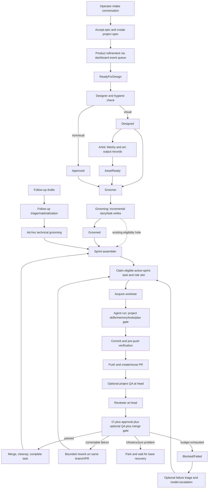

# Forge workflow and correctness review

Reviewed 2026-11-16. Authoritative baseline: `origin/main` commit `4ac44895c05122ff5705a32b4ceb93e60a6e72e5`, inspected in `.portHorizon/review-sources/Forge-main`. Paths and line numbers below refer to that snapshot, **not** the older interactive checkout (`6d0219f`, 105 commits behind). Read-only code review; no production actions, builds, or tests performed by this reviewer. Findings are source-derived; suggested reproductions are not claimed as executed tests.

## Assessment

Forge has a useful engineering core: persistent project queues, isolated worktrees, dependency-aware dispatch, explicit model runs, CI/review/QA gates, and recovery. Current main is materially more capable than the older documentation suggests: messaging wakes stages immediately, QA can run before review, follow-ups are triaged and grouped, and automatic failure triage/escalation is available. A stronger model does not remove the need for those correctness boundaries.

The most important remaining problems are **stage ownership and atomicity**, not model intelligence. Work can enter execution while its plan is still being written; the art and grooming stages compete for the same spec; some project configuration disappears on the dispatch path; recovery takes a different verification path from normal execution. These must be corrected before trusting autonomous creative work.

## Actual flow

This diagram intentionally shows the **actual Designed → Groomer bypass**, not an ideal sequential art pipeline. The published Flow graph (`Core/Workflow/WorkflowDefaults.cs:20`) omits Artist and QA nodes; it is not a complete description of the current runtime.

### Ownership and orchestration

- `Orchestrator/Composition/ForgeComposition.cs` is the composition root. `Program.cs` starts the assembled runtime; it no longer contains the old constructor graph.
- Stores publish typed hint events after commits. `Messaging/EventConsumer.cs:97` handles/commits messages, logs failures, and negatively acknowledges unsuccessful handlers. Its outer loop restarts dead consumers. Hints are in-memory and not authoritative; DB/GitHub rereads and 15-minute backstops reconcile state.
- `TaskEnqueuedConsumer` wakes dispatch, assembly, and grooming (`Orchestrator/Consumers/TaskConsumers.cs:31`). Spec changes wake all three planning schedulers (`SchedulerTriggerConsumers.cs:64`). Sprint changes wake assembly and dispatch. PR-open and verdict events drive the watch fast paths (`WatchConsumers.cs:76`, `:107`).
- Watch polling is now in `WatchSweepService`, separate from the engineering dispatch loop. Reviews and QA launch off-loop, keyed by project/task, with bounded background budgets. This fixes the old global sweep clock and synchronous-review starvation; do not report those as current bugs.
- Per-project workload stores hold issues, specs, sprints, and runs. Shared registry/secrets/skills/policies are distinct concerns. Routing specs explicitly fan out only for scheduler sweeps. Issue IDs remain per-store sequences, so `task-1` is not globally unique.
- Engineering uses the MAF five-stage workflow by default. The optional Durable path still constructs a single workflow against primary stores (`ForgeComposition.cs:332`). It should not be enabled for a multiproject restart without correction.
- Current sprint assembly groups spec work and related follow-up themes, prioritizes themes, excludes open blockers, and caps follow-up batches. The older rule that every follow-up gets a solo sprint is obsolete.

## Findings requiring correction

Severity: P1 means fix before autonomous production use of the affected path; P2 means correctness/operability work that should accompany the restart. Confidence is high unless stated otherwise.

### P1 — Partially groomed plans are eligible for dispatch

`Agents/GroomerAgent.cs:111` sets the spec to Grooming, then each `create_story`/`create_task` call immediately persists rows (`:266`, `:301`). `SprintAssembler.ListEligibleAsync` only demands `groomed=true` for ad-hoc work; a spec-chain task is eligible regardless of the spec's status (`Orchestrator/Sprint/SprintAssembler.cs:903–930`). The later cross-project guard checks owner, not grooming completion (`:1179`). Task creation emits a wakeup to assembly (`TaskConsumers.cs:31–35`).

**Trigger:** groomer creates task A, spends another model round deciding task B and their dependency; assembler wakes in between. A can be sprinted and claimed before the dependency or complete plan exists. A failed groom can leave a partially implemented feature.

**Correction:** stage a decomposition and commit it atomically, or enforce a completed grooming generation on all eligibility checks. Publish a single completed-plan event only after story/task/dependency consistency is verified. Add a controlled interleaving test that pauses grooming after its first task and proves no engineering dispatch occurs.

### P1 — Art production races grooming and can be skipped

Both `ArtistScheduler.cs:128` and `ScheduledGroomer.cs:158` select Designed specs. Every spec-status hint wakes both. Grooming changes Designed → Grooming immediately; AssetReady is not a legal transition from Grooming/Groomed (`Core/SpecStore.cs:83`).

**Trigger:** visual spec becomes Designed. If grooming wins, the artist never selects it; if both start, asset generation can finish after grooming moved the state and fail its final transition. Engineering may already run without assets.

**Correction:** explicit artifact requirements with separate readiness records, or a deterministic art-required routing predicate so only asset-complete visual work becomes groomable. Do not merely delay one scheduler. Test both race orderings.

### P1 — Grooming failure has no automatic recovery state

`GroomerAgent.cs:111` enters Grooming before any model call. The exception handler (`:245`) logs/rethrows without restoring a retryable status. Normal completion also does not require the model to have committed Groomed (`:230–243`); unlike Designer, this call does not pass a required-tool contract to `PipelineAgentRunner`. Scheduled candidates exclude Grooming (`ScheduledGroomer.cs:158`).

**Trigger:** timeout/provider error after entry, process restart mid-groom, or model returning without `set_spec_status`. The spec remains outside the scheduler's candidate set. Partial tasks may still execute because of the prior finding.

**Correction:** persisted grooming attempt with lease/checkpoint, explicit validated output, resumable or rollback-safe partial planning. A failed attempt must become discoverable without manual DB edits. Retrying must not duplicate already-created tasks.

### P1 — Dispatch drops project-specific verification configuration

`OrchestratorAgent.ProjectRecordToOptions` (`:358`) copies ID/name/repo/branch/roles but omits VerifyCommands, Territories, QA flags, visual paths, and triage settings. The bundle retains these options through `ProjectBootstrap` (`Projects/ProjectBootstrap.cs:157`). Normal workflow verification consumes `bundle.Project.VerifyCommands` (`ForgeComposition.cs:376`). Watch consumers already use the canonical `record.ToProjectOptions` mapper (`WatchConsumers.cs:41`), documenting an earlier version of this exact class of bug.

**Impact:** TimeLoop's configured gameplay/import/test commands can silently fall back to auto-detection. Auto-detection only supplies dotnet build/test or nothing (`AgentTools/RunVerification.cs:185`). Note that the runner separately rereads territories, so this does not prove every territory gate is bypassed; the pre-push verification loss is directly traceable.

**Correction:** use one canonical mapping everywhere and refresh mutable bundle configuration. Assert a non-dotnet project's custom verification command actually executes through real composition and dispatch.

### P1 — Creative artifacts are still wired to the primary project

Composition creates design/art stores against `primaryFactory` (`ForgeComposition.cs:196–202`) then gives those fixed stores to the factories consuming the cross-project spec router (`:574–610`). Meshy output root is also primary-derived (`:599–603`). Engineering bundles use their own project artifact stores (`Orchestrator/ProjectDispatchBundle.cs:235`). Designer/Artist visual-language lookup uses the shared unqualified `design/visual-language` key.

**Trigger:** TimeLoop is registered alongside Forge or any other primary project. Its spec is routed correctly but creative output records and files land in primary storage, and its engineering agent queries the TimeLoop stores.

**Correction:** bind every creative run to a project context containing specs, artifacts, files, visual language, skills, and service credentials. Test two projects with distinct visual language and assert artifacts are visible only in the owner's execution context.

### P1 — Merge is not bound to the head that passed gates

Watcher fetches PR head and checks CI/review/QA for that SHA (`Reviewer/PRWatcher.cs:190`, `:236`, `:282`, `:373`), then calls `MergePullRequestAsync(prNumber)` (`:473`). `GitHubService.cs:116–123` creates an empty merge request without expected SHA.

**Trigger:** branch moves between validation and merge. Unless GitHub branch protection independently prevents it, a different head can merge under evidence for the previous head.

**Correction:** pass the expected SHA to GitHub's merge precondition; head mismatch should trigger fresh evaluation, not consume a coding strike. Test simulated movement between status read and merge.

### P1 — Cancelled check runs can count as green CI

`GitHubService.GetCommitStatusAsync` (`:128–153`) returns Success for completed runs unless conclusion is Failure, TimedOut, or ActionRequired. Cancelled, skipped, neutral, null, and other non-success outcomes are therefore accepted, independent of required-check identity.

**Trigger:** manually cancel the only required build/test on the current PR head; reviewer approves. Forge sees green even though tests did not finish. Branch protection may reject the merge, but Forge's decision and diagnosis remain wrong.

**Correction:** define required check names and accepted conclusions explicitly; cancelled is not success. Distinguish no checks configured, pending, required failures, and optional skipped jobs. Validate TimeLoop's required checks before enabling merge.

### P1/P2 — Recovery bypasses normal verification and is not PR-idempotent

AgentCompleted recovery directly commits/pushes/opens a PR (`StartupRecovery.cs:345–370`, `:495–531`). It does not reuse the normal pre-push verifier or branch PR lookup. `TryOpenPrAsync` blindly creates a PR and defaults to main when context lacks the branch (`:517–524`). The primary recovery context does not provide a default branch (`:77`).

**Triggers:** crash after agent completion but before verification → recovery publishes unverified work. Crash after remote PR creation but before local metadata write → recovery attempts a duplicate PR. Non-main primary branch → recovery chooses the wrong base. For no-diff work recovery also lacks the normal explicit-no-op outcome logic.

**Correction:** one idempotent publish operation shared by normal and recovery paths, with durable verification evidence tied to commit, branch lookup before PR creation, and mandatory project base branch. Replay each boundary in a fake or disposable GitHub environment.

### P2 — Engineering in-flight keys collide across projects

`OrchestratorAgent.cs:63` stores `_inFlight` by issue ID; checks/add/removes use only `i.Id`/`dev.Id` (`:236`, `:305`, `:322`). Each store independently generates IDs, so two projects' task-1 entries collide.

**Impact:** unrelated tasks serialize or starve while a same-ID task is running, violating per-project role concurrency. It does not by itself cause a wrong-store write. Use `(projectId, taskId)` consistently, as the review registry already does.

### P2 — Normal execution omits the lifecycle dependency

The Durable workflow gets `lifecycle: lifecycle` (`ForgeComposition.cs:342`); the default InProcess workflow (`:364–376`) does not. `RunAgentExecutor` only reports RunStarted if that dependency is non-null (`Orchestrator/Workflow/RunAgentExecutor.cs:191–206`).

**Impact:** observed agent-start state is missing in normal composition; dashboard/stall timing relies on Dispatching or later events. Wire the dependency and test the real composition path, not only executor constructors.

### P2 — Disabling review also prevents QA from starting

`WatchSweepService.TryLaunchBackgroundReviewAsync` returns when the review step is disabled (`:284–286`), before the QA branch (`:301–305`). The merge watcher independently requires current QA evidence when the project flag is enabled.

**Trigger:** QA-enabled project with review-agent disabled in workflow and a formal human approval. No stage launches the required QA, so merge waits forever. Separate QA orchestration from whether automated review is enabled.

### P2 — Remaining project-grounding leaks

Ad-hoc grooming explicitly calls `BuildGroundingBlockAsync(projectId: null)` (`GroomerAgent.cs:395`) despite having `_projectId`; that helper chooses vision and repo root from its argument (`:573`, `:611`). Product context is constructed once with primary issues/root (`ForgeComposition.cs:559`); `FilesystemProjectContextSource.BuildAsync(projectId)` reads fixed `_repoRoot`/`_issues` (`Core/FilesystemProjectContextSource.cs:82`).

**Impact:** another project's feature/follow-up may be prioritized or rejected against Forge's vision/repo. Binding a run's complete context by project is more robust than repeatedly adding individual lookup parameters.

### P1 — An isolated test rerun automatically waives a failing required suite

`AgentTools/RunVerification.cs:46–75` extracts up to 20 failed test names from console text, appends a filter, and returns a passing gate if that one filtered invocation exits zero. It labels the failures "not caused by this diff." `tests/Forge.Tests/RunVerificationTests.cs:100` explicitly asserts this policy using a fake command. `CommitPushPrExecutor.cs:314–325` logs and publishes a warning, but still proceeds.

**Why this is a correctness defect:** an introduced shared-state leak, ordering dependency, concurrency bug, or intermittent race can fail a full suite and pass in isolation. The isolated success establishes only that the filtered rerun passed; it says nothing causal about the diff. The retry also discards its output, so this code does not verify that all requested test cases actually ran. Console output truncation/parsing can identify only a subset of failures. GitHub's full CI remains a mitigation if correctly configured and required; TimeLoop's checked-in source has no CI workflow, making that fallback a prerequisite rather than an assumption.

**Preserve the useful part:** isolated reruns are excellent diagnostics and can avoid instructing a model to change unrelated code. Keep both the original failing-suite evidence and rerun result. Classify the outcome as unresolved/flaky-suspected, not verified. For a known pre-existing flaky test, require a specific, documented quarantine policy with ownership/expiry and baseline evidence; do not infer a blanket waiver from a single passing rerun. A full-suite rerun can provide additional evidence, but repeated passing runs still do not prove the absence of a race. For the initial correctness-first TimeLoop pilot, unknown suite failures should hold promotion without spending coding strikes until classified.

**Minimal proposed reproduction:** introduce a process-global mutation in test A that makes B fail only when run after A. Run the suite, then B alone. The current policy reports green despite the deliberately introduced defect. This is a proposed regression scenario, not a test executed in this review.

## Additional risks and verification targets

- **Check-then-write state transitions:** `SpecStore.SetStatusAsync:428` validates a separately read state, then updates by ID without an expected-status predicate. `TaskStateMachine.ReportAsync` similarly writes via the passed task status, not an atomic transition against the current DB version. Concurrent watch/event/dispatch writers can overwrite one another. Add compare-and-swap/versioning or serialize per project/task; do not expand the legal table indefinitely to mask races.
- **Background launch race and capacity:** `WatchSweepService:307–322` checks in-flight then starts/assigns without an atomic reservation. Two consumers can launch duplicate reviews in the gap. QA has the same pattern (`:388–401`). Neither path acquires the engineering SlotTable. A provider HTTP limit does not bound total shell/game processes. Use atomic reservations and explicit review/QA/interactive-game capacities.
- **Product refinement is still dashboard-event driven:** the queue uses in-process `IDashboardEventBus` rather than a persisted pending-refinement query. Exceptions are logged, with no durable retry lease. A restart/lost accepted event can leave Draft work awaiting manual action. Verify a reconciliation path before relying on automatic intake.
- **Failure-aging semantics changed:** current `FailureAgingDays` defaults to 7 (`Configuration/AgentOptions.cs:277`); assembler closes old Failed rows (`SprintAssembler.cs:446`). AGENTS still says not to auto-clear Failed issues. This is an instruction/documentation inconsistency, not necessarily an unauthorized implementation: source comments cite later operator direction. Decide restart policy explicitly and keep old state archived so an aged backlog is not silently treated as shipped.
- **“Complete” is not necessarily success:** current `CompletionProgressAsync` correctly refuses to count Failed/Blocked tasks as terminal (`SprintAssembler.cs:523–537`), fixing an older behavior. However, explicitly Closed tasks and failures later closed by aging count toward closure without delivering the feature. Separate task disposition, sprint bookkeeping, feature acceptance, and deployed/playable validation; require acceptance evidence for a release milestone.
- **CI-missing counter lifetime:** the nominal three-zero-signal-poll retrigger uses a `PRWatcher` instance dictionary (`Reviewer/PRWatcher.cs:35`, `:298`). Watch consumers build a new bundle per event (`WatchConsumers.cs:47`), and the factory constructs a new watcher (`ProjectDispatchBundle.cs:248`), so the usual successive sweep events do not retain that counter. A project with no actual CI provider remains blocked regardless; do not describe three-tick retrigger as proven runtime behavior. Persist the evidence/count or share an appropriately scoped watcher, then test the composed consumer path.

## What to keep, simplify, and retire

| Mechanism | Recommendation | Reason |
|---|---|---|
| Per-project stores and context | Keep; strengthen structurally | Prevents wrong-repository work and creative contamination. Model quality cannot solve routing. |
| Worktrees, PRs, current-head review/QA, CI | Keep | Reproducibility and accountability. Add SHA-bound merge. |
| Deterministic plan schema/territory enforcement | Keep | Explicit operator requirement; protects parallel work boundaries. |
| LLM plan critic | Measure; configure by risk | An extra full-model call on every small change can duplicate the engineer/reviewer. Any relaxation needs operator-approved gate policy, not removal of hard enforcement. |
| Persistent lifecycle and recovery | Keep, consolidate | One authoritative state transition/publish path is simpler than many independent repair heuristics. |
| Mandatory 1–3 stories × 1–3 tasks | Replace with acceptance/size criteria | `GroomerAgent.cs:261` explicitly attributes caps to weaker models. Hard counts can force artificial decomposition and omit work. Retain limits on run cost and scope. |
| Minimax leaked-markup nudges | Provider-specific compatibility | `PipelineAgentRunner` permits three continuations. Keep only where measured necessary; structured API outputs should get validated outcomes, not vendor markup repair everywhere. |
| Product → Designer → Artist for all accepted work | Make requirement-driven | A dialogue typo or code-only task should not pay for visual design/3D planning. Creative jobs need real artifact requirements, not another generic LLM hop. |
| Talaria hint bus plus sweep reconciliation | Keep interface initially; assess operational cost | It now gives fast paths and is not the primary bottleneck. Do not replace before measuring. A single-host app need not add a remote transport. |
| Durable workflow runtime | Leave off; consider removal later | Duplicates recovery/runtime surface and is still primary-store-bound. It is not required for one-host TimeLoop. |
| Editable graph, hard-coded workflow, spec states, task states | Reduce semantic duplication | Display graph is not executable routing and omits Artist/QA. Make UI derive from actual stage contracts or label limits honestly. |
| Automatic triage and escalation | Keep opt-in initially | Strong engineering model reduces the value of repeated weak-model retries. Measure escalation success and dollar cost, keep bounded actions and audit. |
| Global visual-language/playbook memory | Replace with project-owned versioned guidance | TimeLoop needs its own art/dialogue/design conventions, not PortHorizon defaults. |

## Proposed future acceptance sequence for a restart

The current scope is review and planning only. The following steps are a future implementation/validation plan, not work performed or queued by this review.

1. Use current main and a new isolated TimeLoop state root; archive old queues and metadata. Do not import failed historical work automatically.
2. Correct atomic planning/readiness and project configuration/context routing before generating work.
3. Prove one small nonvisual task: intake → groom → sprint → worktree → configured checks → PR → current-head review → merge. Record actual cost/time.
4. Prove a visual task with real assets: requirement → production → versioned file import → gameplay evidence → QA → review; assert no execution before required art is ready.
5. Prove a dialogue/design task with domain-specific acceptance and content validation, rather than treating it as a generic code diff.
6. Inject provider timeout, process crash, CI cancellation, branch-head movement, missing art output, and duplicate hints. Require convergence with bounded retries and no duplicate PR/assets.
7. Only then raise concurrency and enable optional automatic triage. Measure bottleneck time by stage, useful accepted changes per dollar, blocked age, reviewer rejection reasons, and gameplay-evidence failures.

## Superseded findings from the old checkout

The initial local-source pass found a global watch-sweep timestamp that could starve later projects, synchronous reviews blocking dispatch, no checkpoint/Claimed recovery leaving tasks stranded, unscoped accepted-epic lookups, and unvalidated groomer story IDs. **Current main fixes these** through WatchSweepService/event consumers, explicit recovery requeue, project-scoped lookup, and parent validation. They are not current findings and should not drive implementation work.
